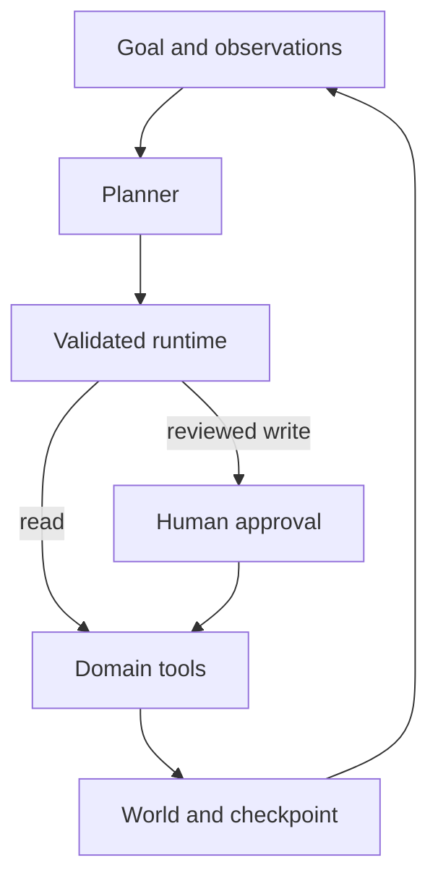

# Dataset Scout Agent

[](https://github.com/blueRav/dataset-scout-agent/actions/workflows/ci.yml)

Plan a small regression experiment while enforcing leakage and holdout boundaries.

A runnable portfolio prototype by Antoine Morales. JavaScript ESM, Node.js 22+, no third-party runtime dependencies. All included data and effects are synthetic.

## What it demonstrates

**Adaptive analysis, constrained experimentation, tool validation, reproducibility.**

The agent profiles a small synthetic campaign dataset, compares a mean baseline with one-feature linear regression, chooses the model by validation MSE, freezes selection, evaluates the held-out test split once, and submits a report derived from tool results.

## Run locally

```bash
git clone https://github.com/blueRav/dataset-scout-agent.git
cd dataset-scout-agent
npm ci --ignore-scripts
npm test
npm run demo
# Inspect .state/run.json for model comparisons, split controls, and the report.
```

The default demo is deterministic and uses no API key. It writes the world and agent checkpoint to `.state/run.json`. Starting without `--resume` begins a new run; meeting sessions reuse memory when `--session` is supplied.

## Optional live model

Copy `.env.example` to `.env`, then set your own `OPENAI_API_KEY` and `OPENAI_MODEL`. The model must support Responses API function tools. Run `npm run live`. This makes billable model calls; all domain tools still operate on the same synthetic data.

Offline CI mocks the provider; it does not validate a live model's quality or availability.

## Behavioral controls

- Data is split chronologically into 60% training, 20% validation, and 20% test.
- Missing spend values are imputed using only observed training values.
- The post-outcome future_revenue column is blocked.
- Model selection uses validation MSE; refitting is blocked after selection.
- Repeated test-result reads reuse the same evaluation.

## Architecture



See [runtime design](docs/runtime.md) for the execution boundary and [development notes](docs/development.md) for the workflow. [Sample trace](examples/sample-run.json) shows the actual deterministic run, including tool results and terminal state.

## Repository map

| Path | Purpose |
| --- | --- |
| `src/project.mjs` | Domain tools, fixtures, and observation-driven planner |
| `src/agent.mjs` | Bounded loop, schema validation, approval gates, receipts |
| `src/provider.mjs` | Optional Responses API planner |
| `src/cli.mjs` | Local demo and checkpoint persistence |
| `test/` | Runtime, domain, and subprocess tests |
| `examples/sample-run.json` | Reproducible offline result |

## Scope and limitations

This is a tiny synthetic regression study with two fixed candidate models and no arbitrary code execution. It does not establish causal effects, production predictive accuracy, statistical significance, or uncertainty bounds. Changing the fixture requires rerunning the tests and sample trace.

Local checkpoint files are trusted inputs. Reviewer names are labels, not authentication. The token ceiling is checked after a model response and is not a strict spend cap. See [runtime design](docs/runtime.md) before attaching external systems.

## Related portfolio projects

- [Relay Ops Agent](https://github.com/blueRav/relay-ops-agent) — Investigate an incident, propose a rollback, pause for approval, and verify recovery.
- [Evidence Trail Agent](https://github.com/blueRav/evidence-trail-agent) — Retrieve sources, read evidence, and submit a brief with verifiable extractive citations.
- [Minute Keeper Agent](https://github.com/blueRav/minute-keeper-agent) — Turn explicit meeting commitments into persistent, reviewable task memory.
- [Agent Gauntlet](https://github.com/blueRav/agent-gauntlet) — Evaluate task completion and safety separately with synthetic adversarial cases and runtime probes.

## License

MIT. Developed with AI assistance; all behavior is open to inspection in the source and tests.
